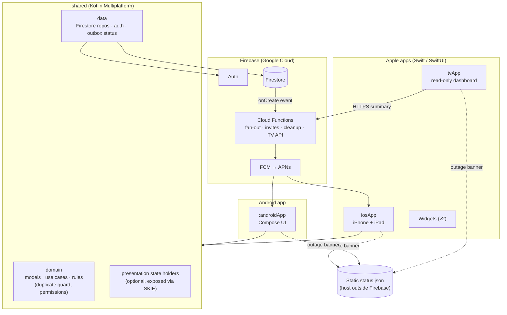
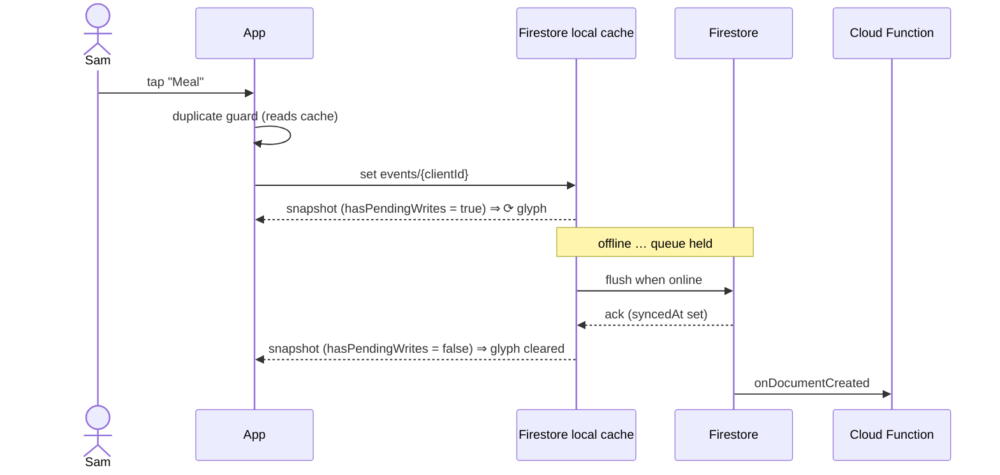
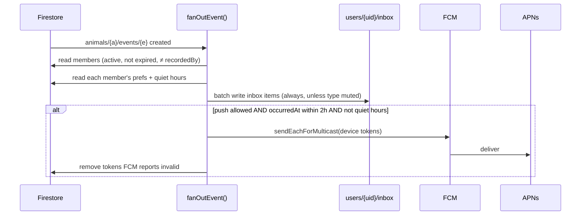
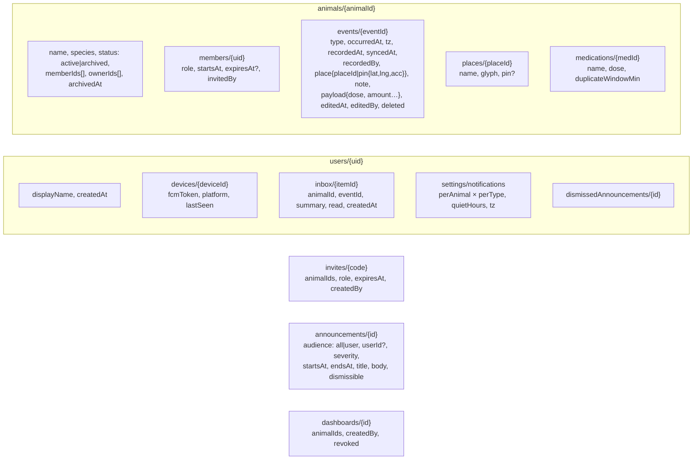
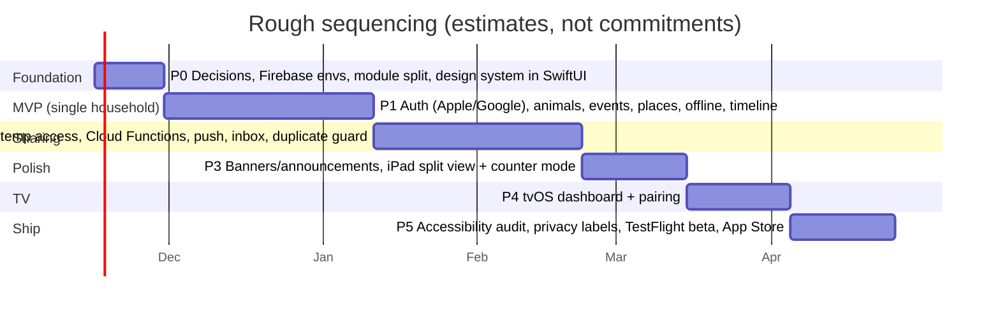

# Dog Trackin' — Implementation Plan

> **Status:** Draft v0.1, written to go with [product-spec.md](product-spec.md). The decisions marked **ADR** are
> recommendations that need sign-off. Estimates are **rough guesses** for one experienced developer and are
> labelled as such. They are not commitments.

## 0. Where the repo is today

- Kotlin Multiplatform with a **shared Compose Multiplatform UI** for Android and iOS (`:composeApp`, `:androidApp`, `iosApp/`).
- Firebase Auth email/password works. Google and Apple sign-in are stubbed. Firestore and Crashlytics dependencies are present but unused.
- One feature (`auth`) follows the `domain / data / presentation` split. Manual DI. CI builds Android and iOS.
- New in this change: design-system tokens (`docs/design-system/`) and their Compose implementation (`designsystem/` package).

## 1. Architecture decisions

### ADR-1: UI stack for iOS, iPadOS and tvOS ⚠ needs your decision

The request says *native iOS app*, *modern iOS development patterns* and a *TV app*. The repo currently draws the iOS UI with
Compose Multiplatform. These pull in different directions:

| Option | iPhone/iPad UI | tvOS | Shared code | Notes |
|---|---|---|---|---|
| **A. Keep Compose MP UI everywhere** | Compose (Material-based, iOS look approximated) | **Not possible with Compose.** To my knowledge Compose Multiplatform does not target tvOS, so the TV app would be SwiftUI anyway. | UI + logic | Least new work now. Least "native" feel. Widgets, Live Activities and App Intents still need Swift. |
| **B. KMP shared core + SwiftUI on Apple + Compose on Android** *(recommended)* | **SwiftUI** (NavigationSplitView, `@Observable`, SF Symbols, Dynamic Type for free) | SwiftUI | Domain, data, sync and rules in Kotlin | Matches "native, modern iOS". Keeps Android possible. Costs two UI layers. |
| **C. Pure Swift, drop KMP** | SwiftUI | SwiftUI | None | Simplest if Android is **not** a goal. Throws away the current KMP scaffolding. |

**Recommendation: B**, unless Android is off the table, in which case **C**. Under B:



- Swift ↔ Kotlin interop: **SKIE** (Touchlab) turns `Flow` into `AsyncSequence` and sealed classes into Swift enums.
  ⚠ I could not confirm from here which SKIE version supports Kotlin 2.3.10; check before adopting.
- Under B, `:composeApp` becomes `:shared` (logic) plus the Android UI. The existing `auth` domain and data layers move over unchanged.

### ADR-2: Offline storage and sync, using Firestore's offline cache (recommended for v1)

Firestore's SDKs keep a local cache and queue writes while offline, then send them when the connection returns. On
Apple and Android, persistence is on by default. That covers FR-F1 to FR-F3 without writing a sync engine.

| | Firestore cache *(recommended)* | Own local DB (SQLDelight/Room KMP) + custom sync |
|---|---|---|
| Effort | Low | High (outbox, retries, conflict handling, schema migrations) |
| "Pending" indicator | `metadata.hasPendingWrites` on snapshots | Full control |
| Cold start with no network ever | Shows only what was cached before | Full control |
| Querying / analytics offline | Limited to cached data | Full SQL |

Implementation notes:
- **Client-generated IDs** for every event, so a retried write is idempotent.
- **Don't `await` the write's completion in the UI.** In the native SDKs, a write's completion fires on server
  acknowledgement, so it can wait indefinitely while offline. ⚠ Check how the `dev.gitlive` wrapper behaves. Write,
  then let the snapshot listener drive the UI.
- `syncedAt = serverTimestamp()`. `occurredAt` and `recordedAt` come from the device clock and are stored together with a time-zone ID.
- "Sync later": Firestore has `disableNetwork()` / `enableNetwork()`, which could back a user-facing "pause sync" toggle (⚠ OPEN whether that's wanted).



### ADR-3: Notification fan-out on the server

Fan-out runs in a **Cloud Function** (TypeScript, 2nd gen) triggered when an event document is created. The client never sends pushes.
Cloud Functions require the **Blaze (pay-as-you-go) plan**.



- Groups events created within 60 s for the same recipients into one push (FR-E4). Exact approach to be decided: a short delay through Cloud Tasks, or a "collapse" key.
- The APNs auth key (.p8) is uploaded to Firebase. This needs a paid Apple Developer account.
- The inbox unread count is used as the app icon badge.

### ADR-4: Announcements and banners

Banners come from two sources, merged on the device, so an outage message still gets through when Firebase is down:

1. `announcements` collection in Firestore (targeted to everyone or to a user), read through a listener.
2. A **static `status.json`** on a host not run by Firebase. It's polled on launch, on foreground, and every 5 min while active.
   ⚠ Hosting choice to confirm. Firebase Hosting would share failure modes with the rest of Firebase.

Connectivity comes from `NWPathMonitor` on iOS and `ConnectivityManager` on Android. Developers publish through a CLI script
(`tools/announce`) that uses the Admin SDK, with a review step for "all users" sends.

### ADR-5: TV dashboard data path

The TV app is SwiftUI on tvOS. Instead of running the full Firebase SDK and a user login on the TV:

- The phone **pairs** the TV: the TV shows a code, the user enters it on the phone and picks animals, and a Cloud Function issues a
  **read-only dashboard token** scoped to those animals.
- The TV polls an HTTPS function, `GET /dashboard`, every 30–60 s and gets a small JSON summary (last event per type, caretakers on duty).
- Revoking the TV from the phone kills the token.
- This avoids depending on the Firebase SDK's tvOS support, which ⚠ I can't confirm the current status of for every product.

### ADR-6: Dependency injection
Keep manual wiring for now, as CLAUDE.md describes. Revisit if the dependency graph grows past about 15 bindings (Koin supports KMP).

## 2. Data model (Firestore)



- `memberIds[]` on the animal document lets one query fetch "my animals". The authoritative role lives in `members/{uid}`.
- **Security rules** (tested with the Firebase Emulator Suite):
  - Read or write an animal only if `members/{request.auth.uid}` exists and (`expiresAt == null` or `request.time < expiresAt`).
  - Create events only when `status == 'active'` and `recordedBy == request.auth.uid`.
  - Delete an animal only when `status == 'archived'` and the caller is an owner.
- A **scheduled function** removes expired temporary members from `memberIds[]` hourly. The rules already block them in the meantime.
- **Deletion cascade:** Firestore does not delete subcollections automatically, so a Cloud Function deletes the events, places and members of a deleted animal.

## 3. Feature packages (shared code)

Each feature mirrors the existing `auth` layout:

```
com.softwareofnote.dogtrackin
├── designsystem/        ← tokens + Compose theme (added in this change)
├── auth/                ← exists; add Apple + Google, account deletion
├── animals/             ← CRUD, archive/restore/delete
├── circle/              ← members, roles, invites, temporary access
├── events/              ← log, edit, timeline, duplicate guard, quick log
├── places/              ← saved places, pin capture (expect/actual location)
├── notifications/       ← inbox, prefs, device-token registration
├── announcements/       ← banner merge logic, status.json client, connectivity
└── sync/                ← pending-writes status, network toggle
```

Platform `expect`/`actual` needs: location (CoreLocation / FusedLocation), connectivity, push-token retrieval, and the Apple/Google sign-in UI flows.

## 4. Phases

Estimates are **rough guesses** in person-weeks for one developer who knows KMP and SwiftUI. They assume ADR-1 = B and will move with your answers.



| Phase | Exit criteria |
|---|---|
| **P0 Foundation** (est. 1–2 wk) | ADRs signed off. Dev and prod Firebase projects. Module restructure. Tokens implemented in SwiftUI. CI green. Emulator-based rules test harness. |
| **P1 MVP** (est. 4–6 wk) | One person can create dogs, quick-log every event type with place or pin, use it offline, archive, restore and delete. Apple, Google and email sign-in plus account deletion. |
| **P2 Sharing** (est. 4–6 wk) | Invite by link or code. Roles enforced by rules tests. Temporary access expires on its own. Push and inbox arrive on a second device. Duplicate guard on meals and meds. |
| **P3 Polish** (est. 2–3 wk) | Banners from both sources and the offline banner. iPad three-column layout. Counter mode. |
| **P4 TV** (est. 2–4 wk) | Paired Apple TV shows live "time since" and caretakers. Revocation works. |
| **P5 Ship** (est. 2–3 wk) | VoiceOver and AX5 pass. Privacy policy and App Privacy labels. External TestFlight. Submission. |

**Total: roughly 15–24 person-weeks (estimate).** The biggest swing factors are ADR-1 and how much of the schedule, shift and medication-reminder scope from the open questions makes it into v1.

## 5. Testing strategy

| Layer | Tooling | What |
|---|---|---|
| Domain rules | `commonTest` + `kotlin.test` (pattern: `AuthViewModelTest`) | Duplicate guard windows, permission matrix, banner priority merge, quiet hours |
| Design tokens | `commonTest` | WCAG contrast pairs (`DesignTokensContrastTest`, added in this change) |
| Security rules | Firebase Emulator + `@firebase/rules-unit-testing` | Every row of the permission matrix, temporary expiry, archive/delete constraints |
| Cloud Functions | Emulator + Jest | Fan-out recipients, token cleanup, cascade delete |
| UI | XCTest / Swift Testing UI tests; Compose UI tests | Quick log, offline banner, duplicate sheet |
| Manual | Two devices + airplane mode script | Offline → online sync, late-sync push suppression |

## 6. Risks

| Risk | Impact | Mitigation |
|---|---|---|
| Push delivery isn't guaranteed (APNs/FCM are best-effort; users may disable it) | Someone misses "already fed" | Inbox is the source of truth; duplicate guard warns at log time |
| Offline device logs a med; another person doses before sync | Double dose | Can't be fully prevented without a connection. Show "offline — others can't see this yet" on med logs ⚠ discuss |
| Clock skew on devices | Wrong "time since" | Show `syncedAt` vs `occurredAt` drift; warn if > 10 min |
| Sign in with Apple private-relay emails | Email invites fail to match | Invite by link/code, not email |
| Firebase costs grow with reads from listeners | Bill | Per-animal listener limits, `limit()` on timelines, budget alerts |
| tvOS / SKIE / gitlive compatibility unknowns | Schedule | Spike each in P0 before committing |

## 7. Immediate next steps (after the open questions are answered)
1. Lock ADR-1 to ADR-5.
2. Create a P0 issue list in GitHub from the phase table.
3. Spike: SKIE + Kotlin 2.3.10, gitlive offline write semantics, and FCM on iOS in this project.
