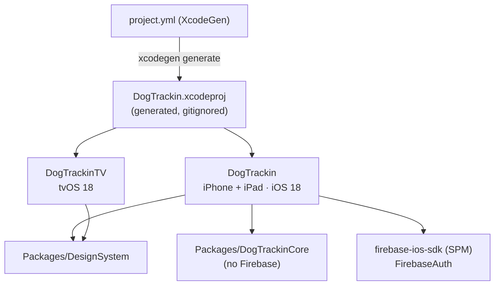
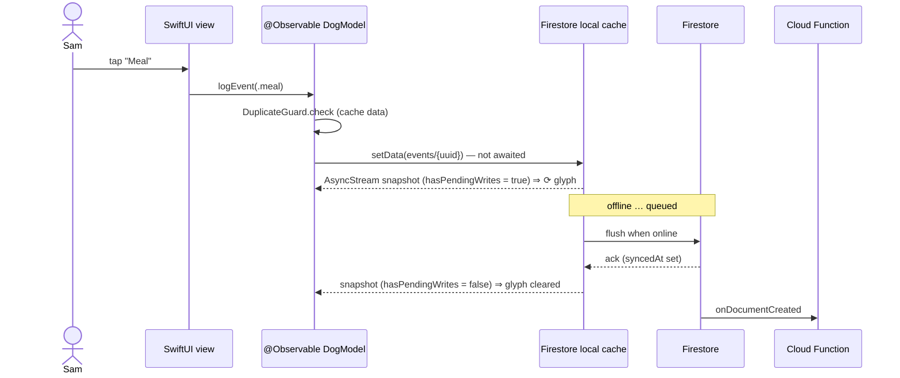
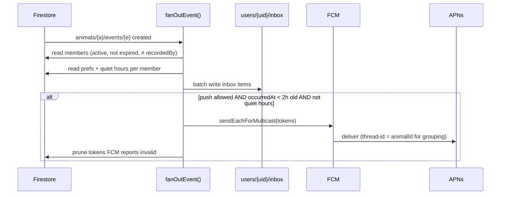
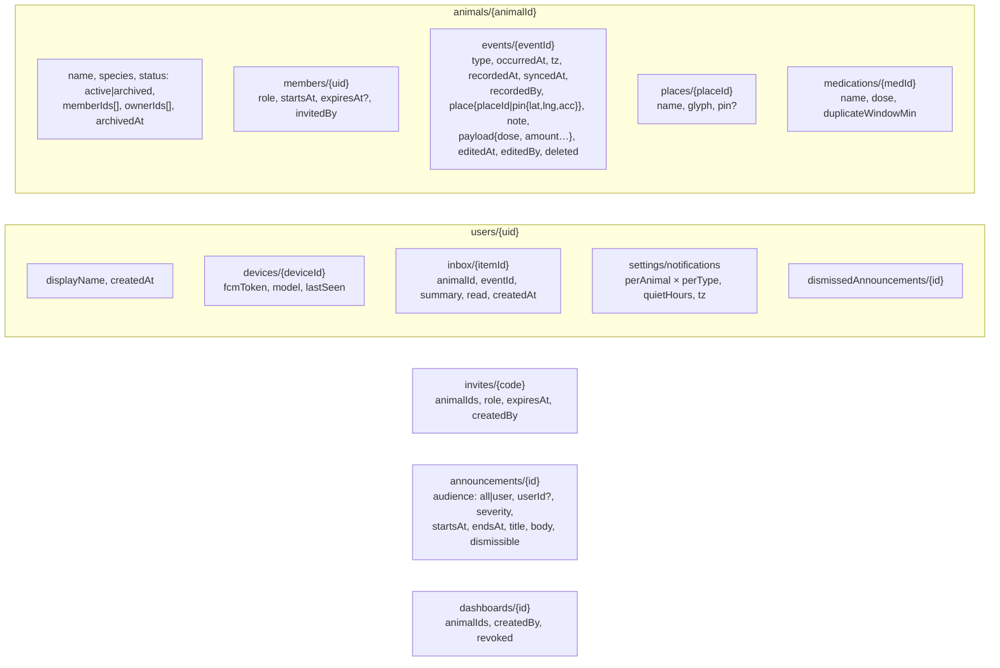
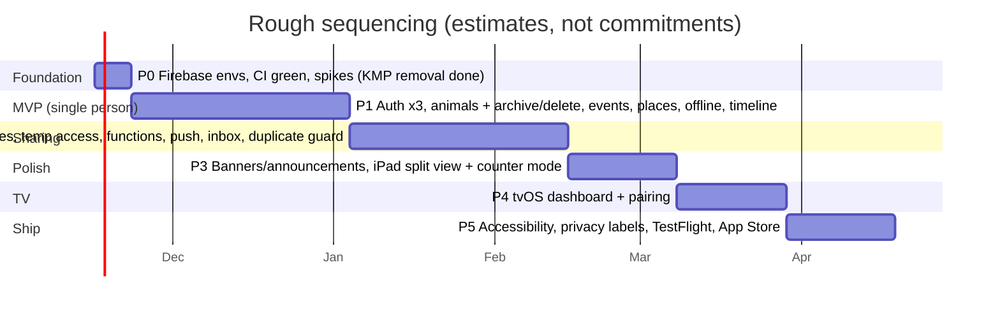

# Dog Trackin' — Implementation Plan

> **Status:** Draft v0.2. Written to go with [product-spec.md](product-spec.md).
> **Decided:** iOS-family only (iPhone, iPad, Apple TV), written in **Swift / SwiftUI**. No Android and no
> Kotlin Multiplatform or other shared cross-platform code.
> Items marked **ADR** are recommendations that still need sign-off. Estimates are **rough guesses** for one
> experienced iOS developer, labelled as such. They are not commitments.

## 0. Where the repo is today

**P0 progress:** the Kotlin Multiplatform / Android project has been **deleted**. The repo is now a Swift-only
project generated by **XcodeGen**:



| P0 item | State |
|---|---|
| Remove Gradle, Kotlin, Android, `.junie`, old `iosApp/` shell | ✅ done |
| XcodeGen `project.yml` with iOS and tvOS targets | ✅ written, **not yet generated or built** (no macOS here) |
| `DesignSystem` and `DogTrackinCore` packages with Swift Testing tests | ✅ written, **not yet compiled** |
| Email/password auth ported from Kotlin (`AuthModel`, `FirebaseAuthRepository`, `LoginView`) | ✅ written, **not yet compiled** |
| CI: package tests + iOS/tvOS builds on `macos-latest`; CodeQL switched to Swift | ✅ written, runs on the first PR |
| Dev and prod Firebase projects | ⏳ needs you (Firebase console) |
| Spikes: offline write semantics, Sign in with Apple → Firebase | ⏳ |

## 1. Architecture decisions

### ADR-1: Pure Swift / SwiftUI ✅ decided

| Concern | Choice |
|---|---|
| Language | Swift 6 with strict concurrency checking |
| UI | SwiftUI. `NavigationStack` on iPhone, `NavigationSplitView` on iPad, the same code on tvOS where it fits |
| State | `@Observable` models (Observation framework), owned by views with `@State` and passed through `@Environment` |
| Async | `async`/`await`. Firestore listeners wrapped as `AsyncStream`s. `@MainActor` for UI models |
| Modularity | Local Swift packages, so each module builds and tests on its own (see §3) |
| Dependency injection | Protocol-based repositories, injected through SwiftUI `Environment` values. Fakes in previews and tests. No third-party DI library |
| Tests | Swift Testing (`@Test`, `#expect`) for logic. XCUITest for a few end-to-end flows |
| Strings | String Catalogs (`.xcstrings`) from day one, even though only English ships |
| Dependencies | Swift Package Manager only: Firebase iOS SDK and GoogleSignIn-iOS |

**Minimum OS: iOS / iPadOS / tvOS 18** ✅ decided.

**Project generation: XcodeGen** ✅ decided. `project.yml` is the source of truth. The `.xcodeproj` is generated and gitignored, so there are no `project.pbxproj` merge conflicts.

**Backend: Firebase** ✅ decided (CloudKit was considered and rejected because of the email/password and Google login requirements).

### ADR-2: Offline storage and sync, using Firestore's built-in cache (recommended for v1)

On Apple platforms the Firestore SDK keeps a local cache and queues writes while offline by default. That covers
offline reading and logging plus automatic sync later, without writing a sync engine.

| | Firestore cache *(recommended)* | SwiftData + custom sync |
|---|---|---|
| Effort | Low | High (outbox, retries, conflicts, migrations) |
| "Pending" indicator | `SnapshotMetadata.hasPendingWrites` | Full control |
| Cold start with no network ever | Only what was cached before | Full control |
| Widgets and TV reading the data | Need a separate path (see ADR-5) | App Group store could be shared |

Implementation rules:
- **Client-generated document IDs** for every event, so retries are idempotent.
- **Never `await` a write's completion in the UI.** The SDK's completion fires on *server* acknowledgement, so it can
  wait indefinitely while offline. Write, then let the snapshot listener update the UI. ⚠ Verify in a P0 spike.
- `occurredAt` and `recordedAt` come from the device clock and are stored with a time-zone ID. `syncedAt` is a `FieldValue.serverTimestamp()`.
- An optional "Pause sync" toggle could use `Firestore.disableNetwork()` / `enableNetwork()` (⚠ OPEN whether it's wanted).



### ADR-3: Sending notifications to the others, from the server

When an event document is created, a **Cloud Function** (TypeScript, 2nd gen) fans it out. Firebase Cloud Messaging
relays to APNs. The client never sends pushes. Cloud Functions require Firebase's **Blaze (pay-as-you-go) plan**.



- Alternative considered: send directly to APNs from the function, without FCM. That's possible, but FCM handles
  token management and retries for us. ⚠ Revisit if you'd rather avoid Google in the push path.
- iOS groups notifications on the device by `thread-id` (one thread per dog). A **Notification Service Extension**
  can rewrite text, for example with localized relative times. Optional, v1.1.
- The unread inbox count sets the app icon badge.

### ADR-4: Announcements and banners

Two sources, merged on the device by a pure, unit-tested `BannerResolver` in `DogTrackinCore`:

1. The `announcements` collection in Firestore (targeted to everyone or to one user), read through a listener.
2. A **static `status.json`** on a host *not* run by Firebase, so outage messages still arrive when Firebase is down.
   It's polled on launch, when the app returns to the foreground, and every 5 min while active. ⚠ Host to confirm.

Connectivity comes from `NWPathMonitor` (Network framework). The banner UI is `BannerView` in the DesignSystem
package, placed with `.safeAreaInset(edge: .top)` so it pushes content down instead of covering it.
Developers publish with a small script using the Firebase Admin SDK (`tools/announce`).

### ADR-5: TV and widget data path

The **tvOS app** and the later **widgets** both need "latest event per type" and nothing else:

- **Cloud Function `GET /dashboard`** returns a small JSON summary for the animals a token may see.
- **TV pairing:** the TV shows a code, you enter it on the phone and pick dogs, and the function issues a read-only, revocable dashboard token, stored in the TV's Keychain.
- The TV polls every 30–60 s. "Time since" counts locally between polls, using `TimelineView`.
- **Widgets** (v1.1) read a summary the main app writes to an App Group container, refreshed by
  `WidgetCenter.reloadAllTimelines()` after each event and by background push. **Interactive widgets and App Intents**
  allow "Log pee" from the Home Screen or with Siri, without opening the app.
- This keeps the full Firebase SDK and a user login off the TV. ⚠ I can't confirm the current tvOS support for
  each Firebase product from here; this design doesn't depend on it.

### ADR-6: Sign-in
- **Sign in with Apple** through `AuthenticationServices` (`SignInWithAppleButton`), passed to Firebase Auth with a nonce.
- **Google** through the GoogleSignIn-iOS SDK (SPM), passed to Firebase Auth.
- **Email/password** through Firebase Auth, with email verification and password reset.
- **Account deletion** in the app (App Store requirement). It calls a Cloud Function that cleans up memberships and
  revokes the Apple token, as Apple requires for Sign in with Apple accounts.

## 2. Data model (Firestore)



- Documents are mapped with `Codable` (`FirebaseFirestore`'s Codable support) to the structs in `DogTrackinCore`.
- **Security rules**, tested in the Firebase Emulator Suite:
  - Read or write an animal only if `members/{uid}` exists and has not expired.
  - Create events only on `active` animals, with `recordedBy == auth.uid`.
  - Delete an animal only when it's `archived` and the caller is an owner.
- A scheduled function removes expired temporary members from `memberIds[]`. The rules already deny them in the meantime.
- A function cascade-deletes the subcollections of a deleted animal, since Firestore doesn't do this automatically.

## 3. Project layout

```
DogTrackin/                        (repo root)
├── project.yml                    XcodeGen spec → DogTrackin.xcodeproj (generated, gitignored)
├── Configs/                       Base.xcconfig; Local.xcconfig (Team ID, gitignored)
├── App/                           iPhone + iPad app target (thin: scenes, wiring, feature views)
│   ├── Sources/DogTrackinApp.swift  @main, Firebase config, environment injection
│   ├── Sources/<Feature>/         Auth ✅, Home (placeholder) ✅, Animals, Events, Circle, Places, Inbox, Settings
│   └── Resources/                 Assets (accent colour ✅), GoogleService-Info.plist (gitignored), Localizable.xcstrings
├── TV/                            tvOS target (dashboard + pairing)
├── Widgets/                       WidgetKit + App Intents extension (v1.1)
├── Packages/
│   ├── DesignSystem/              ✅ exists — tokens, glyphs, components, contrast tests
│   └── DogTrackinCore/            ✅ pure Swift: User, AuthError, AuthRepository, AuthModel;
│                                  next: EventType, Role/permissions, DuplicateGuard, BannerResolver, QuietHours
├── functions/                     Cloud Functions (TypeScript) + rules + emulator tests
└── docs/
```

`DogTrackinCore` has **no Firebase import**. That keeps the rules that matter (duplicate guard, permissions, banner
priority) fast to test and independent of the backend. Firebase-backed repositories live in the app target for now.
If they grow, they can move to a `DogTrackinData` package.

## 4. Phases

Estimates are **rough guesses** in person-weeks for one developer experienced with SwiftUI and Firebase.



| Phase | Exit criteria |
|---|---|
| **P0 Foundation** (est. ≤1 wk remaining) | ~~KMP removed~~ ✅. ~~XcodeGen project with iOS + tvOS targets~~ ✅ (unbuilt). CI green on a macOS runner. Dev and prod Firebase projects. Spikes: offline write semantics, Sign in with Apple to Firebase. |
| **P1 MVP** (est. 4–6 wk) | One person can create dogs, quick-log every event type with place or pin, work offline, and archive, restore and delete. Apple, Google and email sign-in plus account deletion. |
| **P2 Sharing** (est. 4–6 wk) | Invite by link or code (Universal Links). Roles enforced and covered by rules tests. Temporary access expires automatically. Push and inbox arrive on a second device. Duplicate guard on meals and meds. |
| **P3 Polish** (est. 2–3 wk) | Banners from both sources plus the offline banner. iPad three-column layout and keyboard shortcuts. Counter mode. |
| **P4 TV** (est. 2–3 wk) | Paired Apple TV shows live "time since" and caretakers. Revocation works. |
| **P5 Ship** (est. 2–3 wk) | VoiceOver and AX5 audit. Privacy policy and App Privacy labels. External TestFlight. Submission. |

**Total: roughly 14–22 person-weeks (estimate)**, now that part of P0 is done. The biggest swings are schedules/shifts and medication reminders
(open questions), which aren't included in this estimate.

## 5. Testing strategy

| Layer | Tooling | What |
|---|---|---|
| Design tokens | Swift Testing in `DesignSystem` | WCAG contrast pairs (`ContrastTests`) |
| Domain rules | Swift Testing in `DogTrackinCore` | Duplicate guard windows, permission matrix, banner priority, quiet hours, time-zone display |
| Feature models | Swift Testing with fake repositories | `@Observable` model state transitions (the successor to the old `AuthViewModelTest` pattern) |
| Security rules | Firebase Emulator + `@firebase/rules-unit-testing` | Every row of the permission matrix, expiry, archive/delete |
| Cloud Functions | Emulator + Jest | Fan-out recipients, token pruning, cascade delete, dashboard token scope |
| UI | XCUITest | Quick log, offline banner, duplicate sheet |
| Previews | `#Preview` with fakes | Every component in light, dark and AX5 |
| Manual | Two devices + airplane mode | Offline-to-online sync, suppressing pushes for late-synced events |

## 6. Risks

| Risk | Impact | Mitigation |
|---|---|---|
| Push delivery isn't guaranteed (APNs is best-effort; users can turn it off) | Someone misses "already fed" | Inbox is the source of truth; duplicate guard at log time |
| Offline device logs a medication; someone else doses before it syncs | Double dose | Can't be fully prevented offline. Warn the person who logged it ⚠ discuss |
| Device clock skew | Wrong "time since" | Compare `syncedAt` to `recordedAt`; flag drift over 10 min |
| Sign in with Apple private-relay emails | Email invites don't match accounts | Invite by link or code, not by email |
| Firestore read costs from listeners | Bill | Limit timeline queries, use the dashboard summary endpoint, set budget alerts |
| No Swift toolchain in this cloud environment | Swift code here is not compiled until it reaches a Mac or a macOS CI runner | P0 adds an `xcodebuild test` CI job |

## 7. Immediate next steps
1. On a Mac: `brew install xcodegen && xcodegen generate`, then build both schemes and run the package tests. Or open a PR and let CI do it. Fix any compile errors; the Swift code was written without a compiler.
2. Create dev and prod Firebase projects and register the iOS app `com.softwareofnote.dogtrackin`.
3. Answer the remaining open questions, at least sections B–D.
4. Turn the phase table into GitHub issues.
