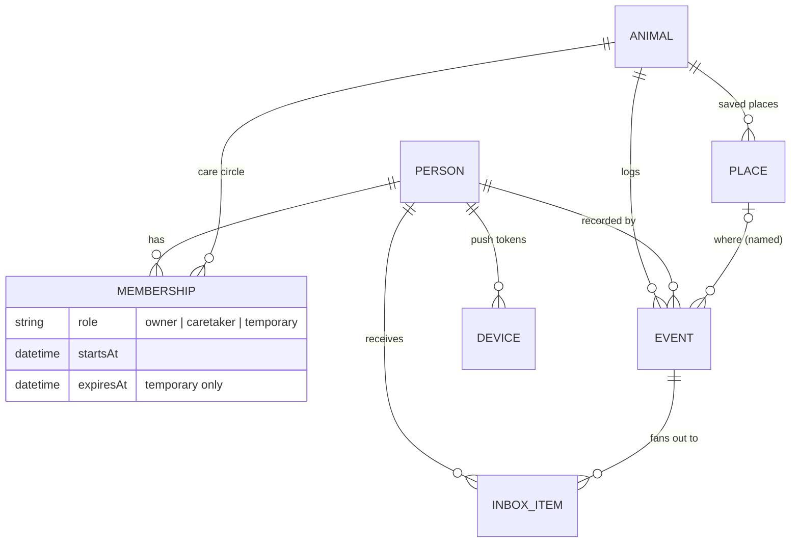
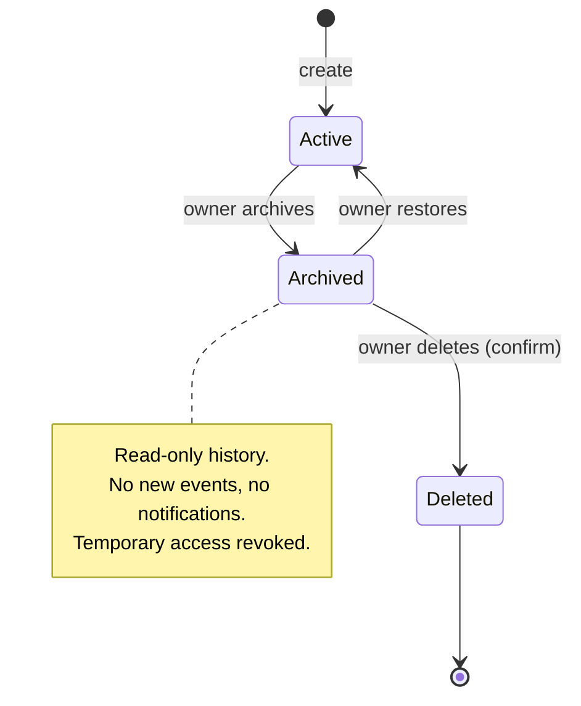

# Dog Trackin' — Product Specification

> **Status:** Draft v0.2 — written for review. Every item marked **⚠ OPEN** depends on an answer in
> [open-questions.md](open-questions.md). Nothing here is final.

**Dog Trackin'** (a pun on *tracking* what the dog does and on *dog-tracking*, the gait where a dog's
rear legs run slightly off the line of its front legs) is a shared care log for pets. Any caretaker logs
an event, such as a feeding, a potty break, a walk or a dose of medication, and every other caretaker hears about it.

---

## 1. Problem

When more people care for a dog than there are dogs, information gets lost:

- "Did anyone feed her?" → double feeding or no feeding.
- "Has he had his pill?" → a missed or **doubled dose** (a safety problem, not just an annoyance).
- "When was she last out?" → accidents in the house.

The app replaces the shouting across the house and the group texts with one log that everyone shares.

## 2. Goals and non-goals

| Goals (v1) | Non-goals (v1, revisit later) |
|---|---|
| Log events in under 3 taps from the dog screen | Medical records / vet integration |
| Notify every other caretaker (push and/or in-app inbox) | Social features, sharing outside the care circle |
| Many people ↔ many animals | GPS walk-route tracking (live) |
| Works offline, syncs later | Automatic sensors / smart feeders |
| Temporary caretakers with limited access | Payments for dog walkers |
| iPhone + iPad, then a read-only TV dashboard | Android, web, Watch app (Watch is a good v2 candidate) |

## 3. Glossary

| Term | Meaning |
|---|---|
| **Account / Person** | One human with their own login. Accounts are never shared. |
| **Animal** | A dog (the data model allows any species, ⚠ OPEN). |
| **Care circle** | The set of people with access to one animal. |
| **Owner** | Full control of an animal, including archive, delete and managing access. |
| **Caretaker** | Ongoing member of the circle. Can log events and see history. |
| **Temporary caretaker** | Time-limited member, such as a dog sitter or walker. Access ends on its own. |
| **Event** | A timestamped log entry: pee, poop, meal, medication, walk, and so on. |
| **Place** | A named location ("Home", "Dog park"), or a dropped pin with GPS coordinates. |
| **Announcement** | A message from the developers to all users or to one user, shown as a banner. |
| **Inbox** | In-app list of notifications the person has not seen yet. |

## 4. Personas

1. **Primary owner (Pat)**: sets up the dogs, invites the family, cares most about medication.
2. **Household caretaker (Sam)**: partner or teen. Logs events quickly and wants to know whether the dog has been out.
3. **Temporary caretaker (Riley)**: a dog sitter for one week. Needs instructions and the ability to log events, and should lose access afterwards.
4. **Glancer**: anyone walking past the TV or the iPad on the counter who wants to know when the dog last ate.

## 5. Relationship model

## 6. Functional requirements

### 6.1 Accounts and sign-in
- **FR-A1** Each person has their own account. No shared logins.
- **FR-A2** Sign-in methods: email and password, **Sign in with Apple**, and **Google**.
  - Note: App Store Review Guideline 4.8 requires an equivalent privacy-focused login option (Sign in
    with Apple qualifies) when a third-party login such as Google is offered. The plan already includes it.
- **FR-A3** Email verification and password reset for email accounts.
- **FR-A4** **In-app account deletion** (App Store requirement for apps that support account creation).
  Deleting an account removes the person from all care circles. ⚠ OPEN: what happens to animals where the
  deleted person was the only owner.
- **FR-A5** Profile: display name (shown on events and in notifications) and an optional initials-based avatar
  drawn from a glyph, not a photo.

### 6.2 Animals
- **FR-B1** Create an animal: name (required), and optionally breed, birth date, weight, notes and care instructions.
  ⚠ OPEN: photos (conflicts with the "glyphs, not graphics" direction).
- **FR-B2** Animal lifecycle:

- **FR-B3** Only an archived animal can be deleted. Deleting it permanently removes the animal and all of its events.
  ⚠ OPEN: grace period or undo window, which owner(s) can delete, and data export before deletion.
- **FR-B4** Archived animals are hidden from the main list and appear in an "Archived" section.

### 6.3 Care circle and access
- **FR-C1** Permission matrix (proposal):

| Capability | Owner | Caretaker | Temporary | TV / dashboard |
|---|:-:|:-:|:-:|:-:|
| View animal profile and care instructions | ✓ | ✓ | ✓ | name only |
| View event history | ✓ | ✓ | ✓ (⚠ OPEN: full or only during access window?) | latest per type |
| Log events | ✓ | ✓ | ✓ | ✗ |
| Edit / delete **own** events | ✓ | ✓ | ✓ (during window) | ✗ |
| Edit / delete **others'** events | ✓ | ⚠ OPEN | ✗ | ✗ |
| Invite / remove people | ✓ | ⚠ OPEN | ✗ | ✗ |
| Edit animal profile | ✓ | ⚠ OPEN | ✗ | ✗ |
| Archive / restore / delete | ✓ | ✗ | ✗ | ✗ |

- **FR-C2** Invites by share link or 6-character code, sent over iMessage, AirDrop, or any other channel. Invites expire.
  Inviting by email address alone is unreliable because Sign in with Apple can hide the real email (see the open questions).
- **FR-C3** Temporary access has a start and an end date and time. It ends automatically, and the server enforces the end.
  The owner can extend or revoke it early.
- **FR-C4** An animal can have several owners (⚠ OPEN). It must always have at least one.

### 6.4 Events
- **FR-D1** Built-in event types:

| Type | Extra fields |
|---|---|
| Pee | — |
| Poop | consistency (optional, ⚠ OPEN) |
| Meal | amount / food (optional) |
| Water | — |
| Medication | medication name, dose (from the animal's saved medication list) |
| Walk | start/end or duration; optional distance |
| Outside (yard) | — |
| Treat | — |
| Grooming / Bath | — |
| Vet visit | notes |
| Note | free text |
| Custom | user-defined name and glyph (⚠ OPEN) |

- **FR-D2** Every event stores:
  - `occurredAt`: when it happened. Defaults to now and can be changed (backdating "fed her at 7").
  - `recordedAt`: when it was entered on the device. `syncedAt` is set by the server.
  - Time zone of the recorder, so "7:00 am" stays meaningful when people are in different time zones.
  - `recordedBy`: the person.
  - **Location**: either a **named place** chosen from the animal's saved places ("Home", "Dog park"),
    **or** a **dropped pin** (latitude and longitude with accuracy), **or** none. A pin can be saved as a new named place.
  - Optional note.
- **FR-D3** **Quick log**: one tap per event type from the animal's screen, with the time defaulting to now and the
  location defaulting to the last-used place. Long-press opens the full editor.
- **FR-D4** **Duplicate guard**: when someone logs Meal or Medication and the same type was logged recently by anyone
  (window configurable per type, for example 2 h for medication), show "Already logged by Sam 12 min ago — log anyway?"
  This is the main safety feature against double dosing.
- **FR-D5** One action can log one event for several animals ("fed both dogs").
- **FR-D6** Edits and deletes are recorded (who and when) so history can be trusted. ⚠ OPEN: whether others are notified of edits.

### 6.5 Notifications
- **FR-E1** When an event is logged, every **other** member of the animal's care circle is notified. The person
  who logged it is not.
- **FR-E2** Two channels, both on by default:
  - **Push** (APNs) to each of the person's devices.
  - **In-app inbox**: unread items waiting the next time the app opens, with a badge count.
- **FR-E3** Per-person preferences: per animal × per event type (push / inbox only / off), plus
  **quiet hours** during which notifications go to the inbox only.
- **FR-E4** Grouping: several events in a short window are combined ("Sam fed Biscuit and Mochi").
- **FR-E5** Events that sync late (logged offline) still go to the inbox. A push is sent only if `occurredAt` is
  recent (proposal: within 2 h) so nobody gets buzzed about a walk from yesterday. ⚠ OPEN
- **FR-E6** Actionable push (v1.1): "Biscuit was fed by Sam" with an action such as "Log water too".

### 6.6 Offline and sync
- **FR-F1** All reading and event logging works with no connection.
- **FR-F2** Unsynced items show a "pending" glyph. A global banner shows "Offline — N changes will sync".
- **FR-F3** Sync happens on its own when the connection returns. A manual "Sync now" action is also available.
  ⚠ OPEN: whether "sync later" means a user-controlled pause, for example to save cellular data.
- **FR-F4** Conflicts: events are append-only records owned by their author, so conflicts are rare.
  For edits to the same record, the last write wins (by server time) and the history is kept (FR-D6).
- **FR-F5** These actions need a connection and are disabled offline with an explanation: invites, accepting an invite,
  account changes, and delete.

### 6.7 Announcements and banners
- **FR-G1** A banner area at the top of every screen, below the navigation bar. Priority order:
  1. Critical announcement (system outage)
  2. Offline / sync status (generated on the device)
  3. Warning announcement
  4. Info announcement
- **FR-G2** An announcement has a target (all users, a single user, ⚠ OPEN: a user segment or app version), a severity,
  a start and end time, a title, a body, an optional link, and whether it can be dismissed. Dismissal is remembered per person.
- **FR-G3** Announcements must reach users **even when the main backend is down**. Proposal: a static status
  file served from a host independent of Firebase, checked alongside the database feed.
- **FR-G4** Developers publish announcements through a small admin tool or script, not by editing the database by hand.

### 6.8 iPad
- **FR-H1** Same features. Uses a split view with three columns: animals, timeline, event detail.
- **FR-H2** Optional "Counter mode": a full-screen dashboard that matches the TV layout, for an iPad kept in the kitchen.

### 6.9 TV dashboard (tvOS)
- **FR-I1** Read-only. For each animal it shows the time since the last **pee/poop/out**, **meal**,
  **medication** and **walk**, with who logged it, plus the current caretakers.
- **FR-I2** Readable from 3 m away. Updates live. When the data is out of date it shows "as of 9:42".
- **FR-I3** Signing in on a TV is clumsy. Proposal: pair the TV with a code entered on the phone, creating a
  read-only "dashboard" credential scoped to selected animals. ⚠ OPEN
- **FR-I4** Clarify the meaning of "current caretakers **assigned**". It may imply a schedule or shift concept (who is on duty now). ⚠ OPEN

## 7. Non-functional requirements

| Area | Requirement |
|---|---|
| Platforms | **Apple only**: iPhone, iPad, Apple TV. Native Swift/SwiftUI, with no cross-platform code. Minimum OS **iOS/iPadOS/tvOS 18**. Android is out of scope. |
| Performance | Quick log feels instant (written locally first). Push delivered within about 5 s of sync in normal conditions. Apple and Google do not guarantee push delivery or timing. |
| Accessibility | Dynamic Type up to AX5, VoiceOver labels on every glyph, WCAG AA contrast (checked in tests), no information conveyed by colour alone |
| Localization | English v1; all strings externalized; dates and times use the device locale |
| Privacy | Location only "When In Use"; pins are visible only to the care circle; App Privacy "nutrition label" completed; no third-party ad SDKs |
| Security | Firestore security rules enforce membership, roles and temporary-access expiry on the **server**. The client is never trusted. |
| Reliability | Crashlytics; announcements work during a backend outage (FR-G3) |
| Data | Export of an animal's history (CSV/JSON) — ⚠ OPEN; retention after account deletion follows the privacy policy |

## 8. Success metrics (proposal)
- At least 80% of an animal's caretakers have push enabled.
- Median time from opening the app to a logged event is under 5 s.
- Duplicate medication warnings that lead to a cancel. This shows the feature prevented a double dose.

See [implementation-plan.md](implementation-plan.md) for how this gets built and
[design-system/design-system.md](design-system/design-system.md) for the visual language.
